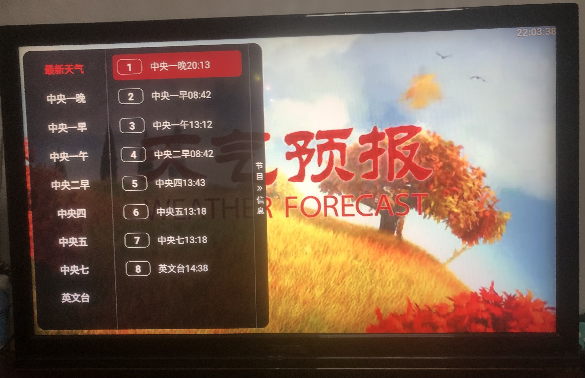

# ☁️☀️气象万千⛈️🌈天气预报❄️气象分析⚡️电视播放m3u列表
cctv 中央电视台 山东卫视 山东新闻 天气预报 气象分析 m3u文件生成

- [☁️☀️气象万千⛈️🌈天气预报❄️气象分析⚡️电视播放m3u列表](#️️气象万千️天气预报️气象分析️电视播放m3u列表)
  - [数据源](#数据源)
  - [生成和使用天气预报m3u文件](#生成和使用天气预报m3u文件)
    - [样例：](#样例)
    - [本地运行：](#本地运行)
    - [在线获取最新的m3u文件：](#在线获取最新的m3u文件)
    - [在线演示器（推荐）](#在线演示器推荐)
    - [食用m3u文件：](#食用m3u文件)
    - [微信打赏🙏：](#微信打赏)
    - [有待完成](#有待完成)


## 数据源
1. https://www.weather.com.cn/video/ylist.shtml
2. [~~农业气象~~，需登录，放弃](https://m.weibo.cn/u/1969156553)
3. https://sdxw.iqilu.com/share/dHYtMjEtNTYyNjU0OQ.html#/
4. https://sdxw.iqilu.com/share/dHYtMjEtNTYyNTg5MQ.html#/

## 生成和使用天气预报m3u文件

### 样例：
[tq.m3u](tq.m3u)

### 本地运行：
```bash
node app.js > tq.m3u
```

### 在线获取最新的m3u文件：

[](https://github.com/AndrewGoal/cctv_weather_forecasting_m3u/actions/workflows/main.yml)

每半小时生成一次，最新版下载网址：

- https://github.com/AndrewGoal/cctv_weather_forecasting_m3u/releases/latest/download/cctv_weather_forecasting.m3u
- 墙内：https://github.moeyy.xyz/https://github.com/AndrewGoal/cctv_weather_forecasting_m3u/releases/latest/download/cctv_weather_forecasting.m3u

### 在线演示器（推荐）

[](https://andrewgoal.github.io/cctv_weather_forecasting_m3u/)

<p align="center">
  <a href="https://andrewgoal.github.io/cctv_weather_forecasting_m3u/"></a>
  <a href="https://andrewgoal.github.io/cctv_weather_forecasting_m3u/"></a>
  <br>
  <sub>左：电脑端 · 右：手机端</sub>
</p>

- 打开页面即在浏览器里直连天气网 / 齐鲁网**实时生成**最新 m3u；失败时自动回退到 GitHub Actions 生成的静态文件
- 打开页面即自动播放；浏览器限制「带声音自动播放」时，会先静音播放并提示，点击页面任意处即可开启声音
- 无广告、无统计，深色界面，手机 / 平板 / 电视浏览器均可使用
- 「最新天气」自动置顶，支持栏目筛选、搜索、自动连播、断网时使用上次缓存
- 播放中每 30 分钟自动检查更新，刷新节目单不会打断当前播放
- 播放器本体已独立为 [海纳百川-播放器](https://github.com/AndrewGoal/m3u-player)，本项目只保留天气数据 Provider 与静态 m3u 兜底

> GitHub 的 README 页面出于安全限制不能嵌入 iframe，所以上面是跳转链接。

<details>
<summary>嵌入到自己的网页（iframe 代码、可选参数、通信方式）</summary>

```html
<iframe
  src="https://andrewgoal.github.io/cctv_weather_forecasting_m3u/?embed=1"
  title="气象万千 · 天气预报表"
  style="width:100%;aspect-ratio:16/10;min-height:560px;border:0;border-radius:16px"
  allow="autoplay; fullscreen; picture-in-picture"
  allowfullscreen
  loading="lazy"></iframe>
```

嵌入模式与可选参数：

| 参数 | 说明 | 示例 |
| --- | --- | --- |
| `embed=1` | 隐藏页头页脚，适合 iframe 嵌入 | `?embed=1` |
| `title=名称` | 覆盖页面标题与品牌名 | `?title=天气` |
| `group=山东早` | 默认打开指定栏目 | `?group=山东早` |
| `play=<视频地址>` | 默认选中指定节目 | `?play=https%3A%2F%2F...%2Fa.mp4` |
| `autoplay=0` | 关闭打开页面时的自动播放（默认开启） | `?autoplay=0` |
| `autoplay=muted` | 打开后直接静音自动播放，不尝试有声播放 | `?autoplay=muted` |
| `m3u=<地址>` | 使用自定义 m3u（该地址需允许跨域） | `?m3u=https://example.com/tq.m3u` |
| `refresh=60` | 自动检查更新的间隔，单位分钟，默认 30 | `?refresh=60` |

> 浏览器策略不允许网页在没有用户交互的情况下**带声音**自动播放，因此播放器会先尝试有声播放，被拦截时自动降级为静音播放；用户点击页面任意处后立即开启声音。如果浏览器本身允许（例如站点已添加到主屏幕/安装为应用，或浏览器配置了免手势自动播放策略），则可以直接有声自动播放。

嵌入页面与父页面之间也可以通信：播放器会发送 `m3u-player:ready`、`m3u-player:change`、`m3u-player:playing` 消息；父页面可发送 `{ type: "m3u-player:refresh" }` 刷新节目单，或 `{ type: "m3u-player:play", url: "视频地址" }` 直接播放某个节目。完整参数与 Provider 接入方式见[海纳百川-播放器文档](https://github.com/AndrewGoal/m3u-player/blob/main/docs/API.md)。

播放器内置 [hls.js](https://github.com/video-dev/hls.js)，除了普通的 mp4 也能播放 HLS（`.m3u8`）直播源。用 `?m3u=` 指向第三方直播列表时需要注意：网页里的播放器受浏览器跨域（CORS）限制，**只有源站返回 `Access-Control-Allow-Origin` 的直播才能播放**；不返回 CORS 头的源站在 VLC、电视盒子、手机上能播，但在网页里会被浏览器拦下。另外 H.265 / AC-3 编码的频道在多数桌面浏览器里也无法解码。

演示页本体使用 [海纳百川-播放器](https://github.com/AndrewGoal/m3u-player) 的静态资源（按 `@v1.6` 锁定版本）；本项目只维护 [`index.html`](index.html) 的配置和 [`weather-provider.js`](weather-provider.js) 实时生成逻辑。[GitHub Actions](.github/workflows/main.yml) 继续每 30 分钟生成静态 m3u，作为原生播放器地址与网页端兜底。如果 `github.io` 访问不畅，也可以自建静态站点，通过 `?m3u=` 指向加速后的 m3u 地址。

</details>

### 食用m3u文件：

- **在线演示（推荐）**：[andrewgoal.github.io/cctv\_weather\_forecasting\_m3u](https://andrewgoal.github.io/cctv_weather_forecasting_m3u/)（自动加载最新 m3u、无广告）
- **旧版演示**：[iptvplayer.stream](https://iptvplayer.stream/import/evgAthl7uR)（不会自动更新，广告较多）
- Mac/iOS平台：[APTV](https://apps.apple.com/tw/app/aptv/id1630403500)
- VLC播放器：⌘ + n 以上m3u网址
- IINA播放器：⇧ + ⌘ + o 以上m3u网址
- 智能电视或电视盒子上利用[TVBoxOSC 20240819-1117版](https://github.com/o0HalfLife0o/TVBoxOSC/releases/tag/20240819-1117)，通过如图设置（并设置启动app直接进入直播），可作为专用的天气预报、气象分析电视app，效果如图：




### 微信打赏🙏：


### 有待完成
- ✅ 数据源1的农业气象视频不再更新，需要 ~~利用[爬虫](https://github.com/dataabc/weibo-crawler)，~~ 从数据源2——农业气象微博上获取，并生成到m3u文件中
- ✅ 数据源3、4
